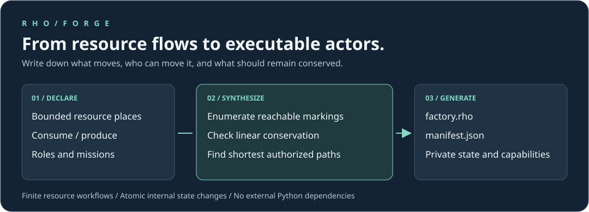
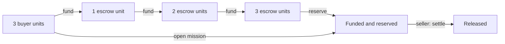
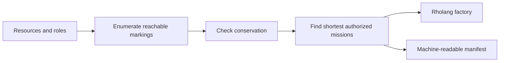

# Rho Forge

[](https://github.com/rhovision-org/rho-forge/actions/workflows/ci.yml)
[](LICENSE)



Rho Forge creates executable Rholang actors from finite resource workflows. Originally developed inside Rho Weave, it is now an independent project.


[Static version](docs/motion/overview.png) · [Motion source](docs/motion/README.md)

## Why I built this

A protocol can have a simple purpose and still require a lot of code to manage resources, permissions and concurrent requests. I wanted to make that translation more direct: describe the resource changes and let the compiler construct the actor.

Forge works with bounded places, consumption and production rules, conservation invariants and role-specific missions. A mission can replace several authorized internal resource transitions with one atomic state-cell update.

## What it adds

Forge treats a workflow as a set of bounded places. A transition takes units out of some places and puts units into others. A marking is simply the count in each place at a particular moment.

A conservation rule says that a weighted total must stay the same. For example, three credit units remain three credit units whether they are in the buyer, escrow or seller place. Forge checks each declared primitive against those conservation rules before it generates the actor.

| Before | With Forge |
| --- | --- |
| Hand-written resource update branches | Generated consume/produce transitions |
| Informally tracked resource totals | Explicit linear conservation rules |
| A manually composed sequence of calls | Shortest role-authorized mission plan |
| Reusable factory with hand-managed state | Generated per-instance private state and revision checks |

## Try it

Python 3.10+ and Git are enough.

```sh
git clone https://github.com/rhovision-org/rho-forge.git
cd rho-forge
python3 -m rhoforge examples/escrow.json --out build-escrow
```

You get two files:

```text
build-escrow/
  factory.rho      Generated Rholang factory
  manifest.json    Markings, role actions and primitive plans
```

The output directory must not already exist. The included escrow example is synthetic accounting, not a payment or custody system.

### Inspect the generated mission

```bash
python3 - <<'PYEX'
import json
from pathlib import Path

m = json.loads(Path("build-escrow/manifest.json").read_text())
step = m["actions"]["buyer"]["0"]["open"]
print("Plan:", step["plan"])
print("Target marking:", m["markings"][step["target"]])
PYEX
```

This prints the four-step path and its final resource marking.

### Try the actor model without a blockchain

```bash
python3 - <<'PYEX'
import json
from pathlib import Path
from rhoforge.compiler import Actor

actor = Actor(json.loads(Path("build-escrow/manifest.json").read_text()))
print(actor.call("buyer", "open", 0))
print(actor.call("buyer", "open", 0))   # STALE
print(actor.call("seller", "settle", 1))
print(actor.call("read", "", 0))
PYEX
```

The Python Actor is the reference interpreter for the generated state machine. It is not a node or an execution of the Rholang source. For actual Rholo reproduction use the [runtime guide](docs/REFERENCE.md#runtime-validation).

### Describe a new workflow

The input JSON contains six fields.

| Field | Meaning |
| --- | --- |
| name | Workflow identifier |
| places | Bounded resource locations, each with capacity and initial count |
| roles | Named operation capabilities |
| transitions | One role, consumed units and produced units per primitive |
| invariants | Named linear conservation weight maps |
| missions | A role and target marking to synthesize |

For example, the funding primitive moves one credit unit from the buyer to escrow:

```json
{"name":"fund","role":"buyer","consume":{"buyer":1},"produce":{"escrow":1}}
```

It is disabled if the buyer has insufficient credit or the escrow capacity would be exceeded. A conservation invariant can prevent the specification from creating or destroying credit unintentionally.

Copy [the full example](examples/escrow.json), change the places and transitions consistently, and compile to a new directory.

## A small example

Imagine reserving an item with three units of internal credit. Each funding action moves one unit into escrow. The reservation action moves the item from available to reserved.



Forge finds the four-step path to the buyer's `open` goal. The resulting actor updates the internal state in one operation. It cannot use the seller's capability to release funds on the buyer's behalf.

Each factory call creates a separate instance. The returned operation capabilities accept an action name, an expected revision and a reply channel. If two requests use the same starting revision, one may succeed and the other becomes stale. This is serialization of a private state cell, not a transaction spanning external contracts.

## How it works



## Using the generated actor

Compose a factory invocation with the generated Rholang source. The public factory name is in the manifest. Each invocation returns a view capability and separate operation capabilities in sorted role-name order.

```rho
new ready in {
  @"rhoForge_escrow_0ff8383b9b4703a8"!(*ready) |
  for (view, buyer, seller <- ready) {
    new reply in {
      buyer!("open", 0, *reply) |
      for (@result <- reply) { @"out"!(result) }
    }
  }
}
```

The tuple is (status, state ID, revision, primitive plan).

| Status | Meaning |
| --- | --- |
| OK | A state-changing operation succeeded; revision increases |
| STALE | The expected revision does not match |
| DENIED | Operation is not admitted at this marking for this role |
| ALREADY | The requested mission is already satisfied |
| EXHAUSTED | Revision ceiling reached |
| READ | Current state and revision without mutation |

A capability is a private name, not an authenticated username. The application must control how these names are distributed. Do not expose them to untrusted process contexts. Forge is not a custody system or a cross-contract atomic transaction engine.

## What makes Forge different from Foundry?

Forge uses consumption/production rules and linear conservation over resource markings, with a separate read capability and explicit mission plans in actor replies. Foundry uses integer deltas, general linear guards and predicates over reachable states. They have different input formats and generated interfaces. They overlap in purpose, but can be developed and evaluated independently.

For the complete input and actor interface, see the [technical reference](docs/REFERENCE.md).

## Validation

The original [151 runtime executions](evidence/runtime-original.json) were recorded before separation, in [Rho Weave at cbfa663](https://github.com/rhovision-org/rho-weave/tree/cbfa663e94d86c20c8f23b49a753d6141b084f30/forge). The standalone CI has now repeated all 151 native executions successfully using its own local harness. See the [standalone runtime evidence](evidence/runtime.json) and [4/4 successful CI jobs](https://github.com/rhovision-org/rho-forge/actions/runs/45790239766).

## Limits and contribution

The compiler accepts up to 12 places, 8 roles, 32 primitives, 16 missions and 128 reachable markings. It rejects conservation violations, oversized state spaces and invalid input. Its source output is bounded to 512 KB. Resource exhaustion is reported as UNKNOWN.

The generated actor models internal finite accounting. It does not implement real asset transfers, external consent, identity, durable recovery or a general-purpose Rholang compiler. It is not production-certified. The current runtime evidence covers the included fixture, including concurrent requests and separate instances.

| Path | Contents |
| --- | --- |
| [rhoforge/](rhoforge/) | Compiler, CLI and reference interpreter |
| [examples/](examples/) | Resource workflow and generated files |
| [tests/](tests/) | Compiler and actor tests |
| [tools/](tools/) | Native isolated Rholo runtime harness |
| [evidence/](evidence/) | Original and standalone runtime observations |
| [docs/](docs/) | Technical reference and visual documentation |

Run the compiler tests with `python3 -m unittest discover -s tests -v`. A useful contribution is a small workflow with a clear expected plan or a reproducible counterexample.

## The Rho project family

The four projects share an idea: make the parts of engineering that can be expressed precisely easier to inspect, reuse and execute. They are independent tools, not four stages of a mandatory runtime stack.

| Project | Focus | Capability |
| --- | --- | --- |
| [Rho Observer](https://github.com/rhovision-org/rho-observer) | Read-only evidence | Compare configured endpoints and keep missing or conflicting evidence visible. |
| [Rho Weave](https://github.com/rhovision-org/rho-weave) | Decision policies | Synthesize safe finite strategies when observations leave several states possible. |
| **Rho Forge (you are here)** | Resource-flow actors | Generate Rholang actors from consumption, production, conservation and role-specific missions. |
| [Rho Foundry](https://github.com/rhovision-org/rho-foundry) | Guarded contracts | Generate Rholang factories from bounded integer resources, guards, invariants and goals. |

### How they relate

Forge focuses on how resources move. If a workflow is naturally described as tokens moving between bounded places, its consume/produce notation and conservation checks are a useful starting point. Foundry is an alternative for workflows that need general linear guards and goal predicates. Both generate executable Rholang; neither is a required backend for the other.

Observer concerns the reported state of the network, while Weave concerns decisions when relevant information is missing. Forge does not consume their outputs automatically.

For a concrete example of how a developer could combine the ideas, see [the ecosystem guide](docs/ECOSYSTEM.md). The examples are architectural illustrations, not claims of an existing integrated deployment.

## License

[Apache License 2.0](LICENSE).
