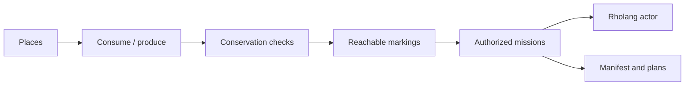

# Rho Forge

**Move resources, not hand-written state branches.**

[](https://github.com/rhovision-org/rho-forge/actions/workflows/ci.yml) [](LICENSE)

Created by **[AixAria](https://github.com/aixaria0)** ([@aixaria0](https://github.com/aixaria0)).

Picture a small marketplace. A buyer has three credits. An item is available. The credits should move into escrow, and the item should become reserved. The buyer must not be able to release the seller's funds.

That is already most of the description Forge needs.

I built Rho Forge to express a workflow in terms of what gets consumed, what gets produced and what must remain conserved, then generate the Rholang actor instead of writing every transition manually.


[Still image](docs/motion/overview.png) · [How the animation was made](docs/motion/README.md)

## A workflow becomes an actor

The included [escrow example](examples/escrow.json) uses three synthetic credit units and one item. Three funding actions plus one reservation action form a buyer-authorized mission called `open`.

Forge finds that path and generates a single internal state update. The seller's release remains a separate operation. The animation illustrates the primitive path; the generated mission does not expose its intermediate markings.

Every instance has its own private state and capabilities. Two calls that try to change the same revision cannot both commit.

This is internal accounting, not a real escrow, payment product or external asset transfer.

## Make one

With Git and Python 3.10+:

```sh
git clone https://github.com/rhovision-org/rho-forge.git
cd rho-forge
python3 -m rhoforge examples/escrow.json --out build-escrow
```

Open `build-escrow/factory.rho` to see the generated actor. The manifest describes its markings, role-specific operations and the primitive steps behind each mission.

Try the actor's local reference interpreter:

```python
import json
from pathlib import Path
from rhoforge.compiler import Actor

actor = Actor(json.loads(Path("build-escrow/manifest.json").read_text()))
print(actor.call("buyer", "open", 0))
print(actor.call("buyer", "open", 0))
print(actor.call("seller", "settle", 1))
```

Run from the repository root. The results are OK, STALE, OK. The first call opens the reservation; the second uses an old revision; the seller then releases the resources. This is a local model demonstration, not a network execution.

## Why use this instead of writing the actor?

Forge makes conservation and authority explicit before code generation. It checks every declared primitive against linear conservation invariants, explores reachable bounded markings and uses shortest paths over a role's own allowed transitions. It then emits a Rholang factory, private instance state, a view capability and separate operation capabilities.



Forge and Foundry overlap, but they are not the same compiler. Forge uses resource places and consume/produce rules, with explicit primitive plans in actor replies. Foundry uses integer deltas, general linear guards and goal predicates. Choose the representation that fits the workflow.

For the supported input format, actor calling convention, revision limits, actual Rholo execution and reproduction instructions, see the [technical reference](docs/REFERENCE.md) and [complete walkthrough](docs/GUIDE.md).

The standalone [runtime CI](https://github.com/rhovision-org/rho-forge/actions/runs/45790239766) recorded 151 matching executions against the pinned Rholo binary. The [raw results](evidence/runtime.json) are checked into the repository. No live network deployment, custody or general-purpose compilation is claimed.

## The Rho family

- **[Rho Observer](https://github.com/rhovision-org/rho-observer)** — See what the network actually reports.
- **[Rho Weave](https://github.com/rhovision-org/rho-weave)** — Find a safe next move when information is missing.
- **[Rho Foundry](https://github.com/rhovision-org/rho-foundry)** — Turn guarded rules into executable contracts.

Forge and Foundry both generate contracts, but start from different descriptions. Observer is about network evidence; Weave is about decisions under uncertainty. Neither is needed to compile a Forge workflow.

They share a direction, not an automatic integration. [See how the pieces could fit together](docs/ECOSYSTEM.md).

## License

[Apache License 2.0](LICENSE). External software remains under its own license.
