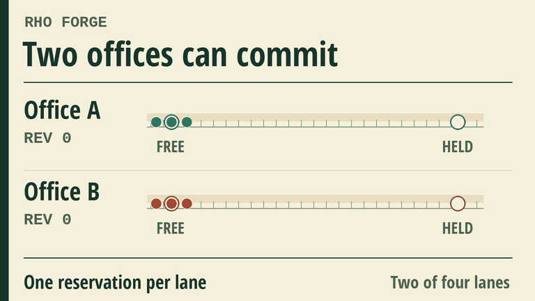

# Rho Forge

Two box offices each have three seats. A clerk at one office shouldn't have to redo a reservation just because the other office made one first.

Forge starts with where resources are and who can move them. It generates Rholang actors, and when the workflow has genuinely independent parts, it gives each one a revision of its own.

Created by [AixAria](https://github.com/aixaria0).



[Static storyboard](docs/motion/overview.png) · [Text walkthrough](docs/motion/README.md)

## Put each office on its own revision

In the venue example, each office tracks its free, held and issued seats. Reserving consumes free seats and produces held seats. The number of seats stays constant. A clerk's `reserve_all` mission does the necessary steps in one update.

Forge reads the places that each rule or mission touches and keeps related places together. Independent groups become *lanes*, each with private state and send-only handles for reading and for each role. A mission that touches several places keeps them in the same group. Each actor checks the expected revision, so two calls at that revision in one lane still compete for a single commit. [Partitioned factory and authority](docs/PARTITIONING.md)

### Compile the four offices

Use Git and Python 3.10+.

```sh
git clone https://github.com/rhovision-org/rho-forge.git
cd rho-forge
python3 -m rhoforge examples/venues.json --partition --out build-venues
```

Expect four lane IDs (`free_a` through `free_d`) and **40 stored markings**, the resource-count combinations in their individual tables. `build-venues/factory.rho` defines the factory. Place it inside a Rholang `new factory` scope and ask it to create a lane by name. Use `manifest.json` to see its initial marking, role order, allowed operations and mission plans.

To change the first office to four seats, edit a copy of the specification. Set the capacities of `free_a`, `held_a` and `issued_a` to four, start `free_a` at four and update the `reserve_all_a` target. Compile into a new directory and inspect the other three tables. [Venue specification](examples/venues.json) · [Calling the factory](docs/PARTITIONING.md#calling-the-generated-factory)

## Why partitioning changes the fit

The one-seat version of the four-office fixture has 81 combinations in a single global table. The partitioned compiler stores 12 local markings. It handles the larger three-seat version in 40 local markings, where the global compiler exceeds its 128-marking limit.

| Four offices, one seat each | One state cell | Independent lanes |
| --- | ---: | ---: |
| Stored markings | 81 | 12 |
| Generated Rholang bytes | 90,079 | 7,167 |
| Median compile time | 5.557 ms | 0.674 ms |

The table is from 25 compiler samples per backend in one GitHub CI run. The native check used three seats per office and exercised simultaneous commits across lanes, a same-revision race within one lane, role denial and instance isolation. [Benchmark and native results](https://github.com/rhovision-org/rho-forge/actions/runs/45805239389) · [Repeat the native probe](docs/PARTITIONING.md#evidence-and-bounds)

Use the flat compiler when you want one revision across all places. The escrow example walks through a buyer-authorized opening mission and a seller-authorized release of synthetic credits. Forge checks conservation for each primitive and finds shortest authorized paths to mission targets before it emits the actor. [Escrow walkthrough](docs/GUIDE.md) · [Input and actor reference](docs/REFERENCE.md)

## What happens after a call is interrupted?


[Weave](https://github.com/rhovision-org/rho-weave) can take the manifest for an office, a role and a goal, then build a controller that finishes issuance after a lost reply. [Run the native recovery demo](https://github.com/rhovision-org/rho-weave/blob/main/docs/RECOVERY.md)

If your application reads outside the actor, [Observer](https://github.com/rhovision-org/rho-observer) can supply evidence for the exact finalized block it reads. The actor's revision and capability still govern the next write. For a single large ledger with arithmetic guards or quotas, [Foundry](https://github.com/rhovision-org/rho-foundry) provides a different way to compile the contract. [Interface map](docs/ECOSYSTEM.md)

[Repository structure and contributions](docs/DEVELOPMENT.md) · [CI](https://github.com/rhovision-org/rho-forge/actions)

## License

[Apache License 2.0](LICENSE). External software remains under its own license.
