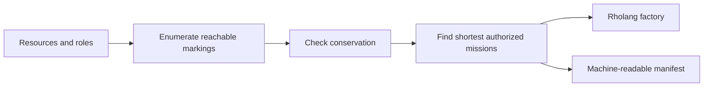

# Rho Forge

[](https://github.com/rhovision-org/rho-forge/actions/workflows/ci.yml)
[](LICENSE)

**Describe the resources. Declare the goal. Generate the actor.**

Rho Forge creates executable Rholang actors from finite resource workflows. Originally developed inside Rho Weave, it is now an independent project.

## Why I built this

A protocol can have a simple purpose and still require a lot of code to manage resources, permissions and concurrent requests. I wanted to make that translation more direct: describe the resource changes and let the compiler construct the actor.

Forge works with bounded places, consumption and production rules, conservation invariants and role-specific missions. A mission can replace several authorized internal resource transitions with one atomic state-cell update.

## Try it

Python 3.10+ and Git are enough.

```sh
git clone https://github.com/rhovision-org/rho-forge.git
cd rho-forge
python3 -m rhoforge examples/escrow.json --out build-escrow
```

Open the generated factory and manifest. The included escrow example is synthetic accounting, not a payment or custody system.

## How it works



## Project family

- [Rho Observer](https://github.com/rhovision-org/rho-observer) — observe network readiness and evidence.
- [Rho Weave](https://github.com/rhovision-org/rho-weave) — synthesize decisions under uncertainty.
- [Rho Foundry](https://github.com/rhovision-org/rho-foundry) — generate contracts from finite integer resources, guards and goals.

These are independent tools, not required runtime dependencies.

## Validation

The original [151 runtime executions](evidence/runtime-original.json) were recorded before separation, in [Rho Weave at cbfa663](https://github.com/rhovision-org/rho-weave/tree/cbfa663e94d86c20c8f23b49a753d6141b084f30/forge). The standalone CI reruns the native Rholo checks with its own local harness.

## License

[Apache License 2.0](LICENSE).
