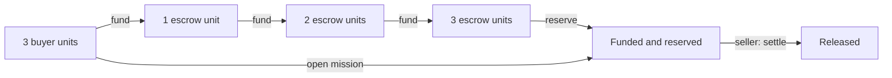
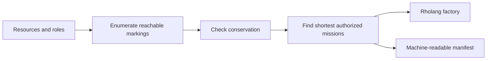

# Rho Forge

[](https://github.com/rhovision-org/rho-forge/actions/workflows/ci.yml)
[](LICENSE)


Rho Forge creates executable Rholang actors from finite resource workflows. Originally developed inside Rho Weave, it is now an independent project.

## Why I built this

A protocol can have a simple purpose and still require a lot of code to manage resources, permissions and concurrent requests. I wanted to make that translation more direct: describe the resource changes and let the compiler construct the actor.

Forge works with bounded places, consumption and production rules, conservation invariants and role-specific missions. A mission can replace several authorized internal resource transitions with one atomic state-cell update.

## Try it

Python 3.10+ and Git are enough.

```sh
git clone https://github.com/rhovision-org/rho-forge.git
cd rho-forge
python3 -m rhoforge examples/escrow.json --out build-escrow
```

Open the generated factory and manifest. The included escrow example is synthetic accounting, not a payment or custody system.

## A small example

Imagine reserving an item with three units of internal credit. Each funding action moves one unit into escrow. The reservation action moves the item from available to reserved.



Forge finds the four-step path to the buyer's `open` goal. The resulting actor updates the internal state in one operation. It cannot use the seller's capability to release funds on the buyer's behalf.

Each factory call creates a separate instance. The returned operation capabilities accept an action name, an expected revision and a reply channel. If two requests use the same starting revision, one may succeed and the other becomes stale. This is serialization of a private state cell, not a transaction spanning external contracts.

## How it works



## What makes Forge different from Foundry?

Forge uses consumption/production rules and linear conservation over resource markings, with a separate read capability and explicit mission plans in actor replies. Foundry uses integer deltas, general linear guards and predicates over reachable states. They have different input formats and generated interfaces. They overlap in purpose, but can be developed and evaluated independently.

For the complete input and actor interface, see the [technical reference](docs/REFERENCE.md).

## Project family

- [Rho Observer](https://github.com/rhovision-org/rho-observer) — observe network readiness and evidence.
- [Rho Weave](https://github.com/rhovision-org/rho-weave) — synthesize decisions under uncertainty.
- [Rho Foundry](https://github.com/rhovision-org/rho-foundry) — generate contracts from finite integer resources, guards and goals.

These are independent tools, not required runtime dependencies.

## Validation

The original [151 runtime executions](evidence/runtime-original.json) were recorded before separation, in [Rho Weave at cbfa663](https://github.com/rhovision-org/rho-weave/tree/cbfa663e94d86c20c8f23b49a753d6141b084f30/forge). The standalone CI has now repeated all 151 native executions successfully using its own local harness. See the [standalone runtime evidence](evidence/runtime.json) and [4/4 successful CI jobs](https://github.com/rhovision-org/rho-forge/actions/runs/45790239766).

## License

[Apache License 2.0](LICENSE).
