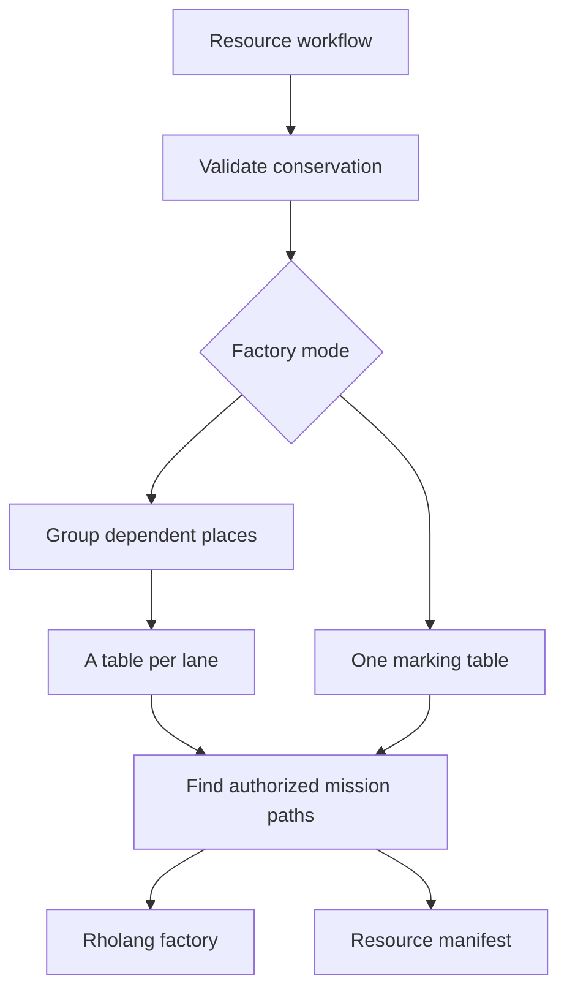

# Working on Forge

`rhoforge/compiler.py` validates resource flows and conservation, builds the reachable marking table, and finds shortest permitted mission paths. `rhoforge/partition.py` groups places by what each transition and mission touches. Its factory keeps a separate state and revision in every instance. `examples/escrow.json` uses the flat compiler. `examples/venues.json` covers the four-lane layout.



The [reference](REFERENCE.md) describes input and the flat actor interface. See the [partitioned factory](PARTITIONING.md) for role order, state scope and the native race probe. For a first end-to-end contract use the [escrow walkthrough](GUIDE.md).

```sh
python3 -m unittest discover -s tests -v
python3 -m rhoforge examples/venues.json --partition --out build-venues
```

For reviews, explain which resources an operation touches even when it leaves a resource count unchanged. Test conservation and permissions, and show cases where paired calls should commit independently or share a revision check. The probe scripts in `tools/` verify generated actors against a pinned Rholo revision. [CI workflow](../.github/workflows/ci.yml)
